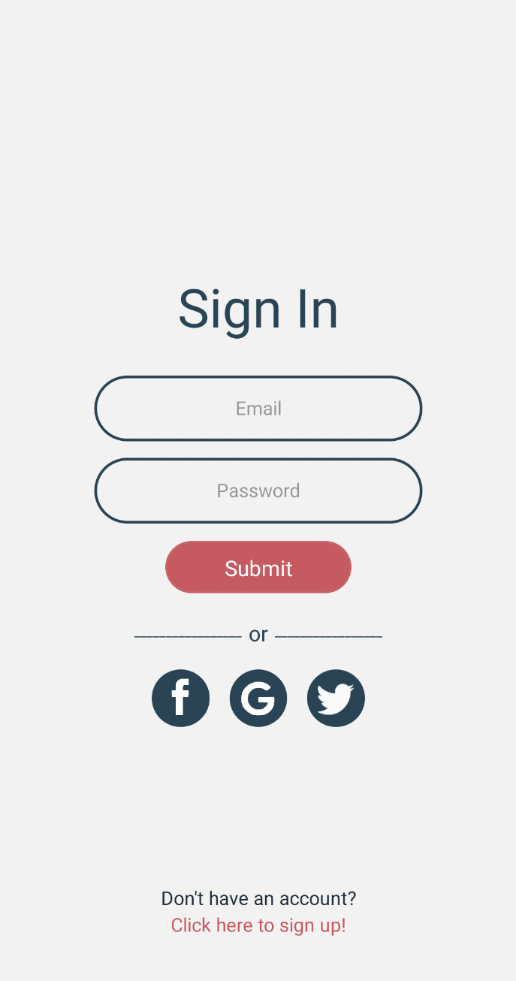
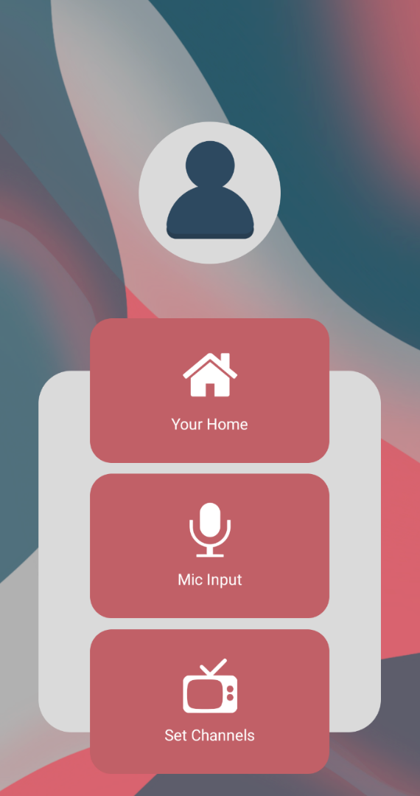
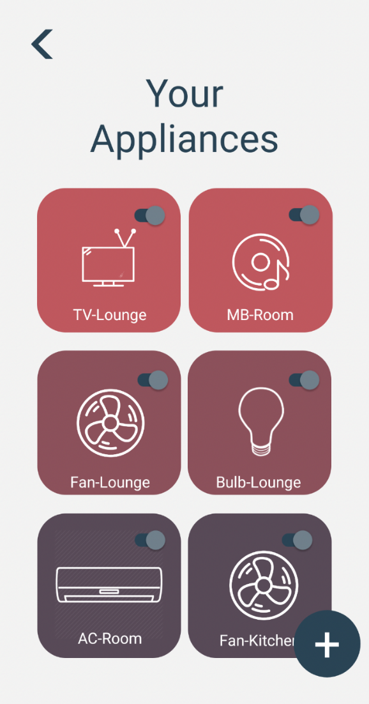
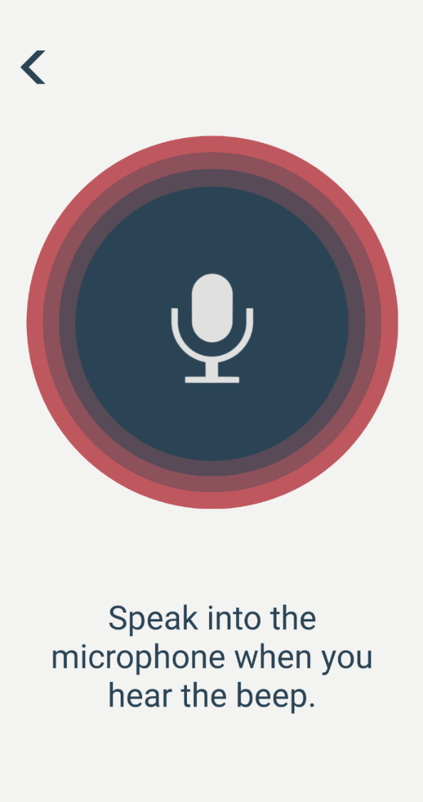
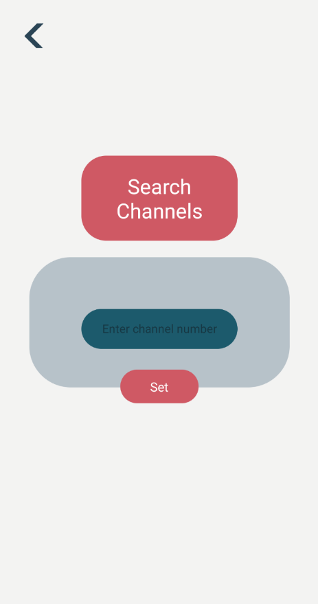
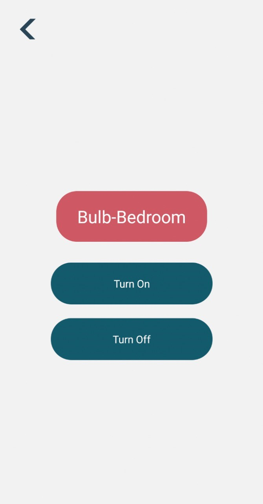

# Automate It

An Urdu voice-controlled home automation system built as a university final-year project. Automate It combines a React Native mobile app, a Go API, a Raspberry Pi/Flask control service, and custom speech-recognition models to control common home appliances by voice or touch.

[](https://github.com/SameetAsadullah/automate-it/actions/workflows/quality.yml)
[](LICENSE)

> This repository preserves the original 2022 implementation and complete commit history. Review [Security and limitations](#security-and-limitations) before connecting it to real home-control hardware.

## System capabilities

- Urdu trigger-word and command recognition using custom TensorFlow/Keras models
- Voice and touch control for lights, air conditioners, televisions, and music
- A cross-platform React Native application with authentication and device screens
- A Go/Fiber API backed by MongoDB for user and channel data
- Raspberry Pi GPIO integration through a local Flask control service
- A self-collected Urdu home-automation speech dataset

## System overview

```text
React Native app
   |-- user accounts and channel data --> Go/Fiber API --> MongoDB
   |-- audio and appliance commands ----> Flask service --> ML models --> Raspberry Pi GPIO
```

For component responsibilities and data flow, read [Architecture](docs/ARCHITECTURE.md).

## Repository layout

| Path | Purpose |
|---|---|
| `src/` | React Native screens, navigation, Redux state, and API configuration |
| `android/`, `ios/` | Native React Native projects |
| `automate_it_server/` | Go/Fiber account and channel API |
| `Hardware Code/` | Flask service and Raspberry Pi inference/control code |
| `Models Code/` | Model-training and dataset-preparation notebooks |
| `Models/` | Exported TensorFlow SavedModels used by the system |
| `extras/` | Application and hardware screenshots |

## Prerequisites

- Node.js 16 or 18 and npm
- React Native Android development environment (Android Studio, SDK, and JDK)
- Go 1.17 or newer
- MongoDB running locally
- Python 3 with the dependencies in `Hardware Code/requirements.txt`
- Raspberry Pi and connected appliance-control hardware for physical automation

The project uses React Native 0.66 and other period-specific dependencies. A modern toolchain may require compatibility work; Node.js 18 is the safest starting point for reproducing the original environment.

## Local setup

### 1. Mobile application

```bash
npm install --legacy-peer-deps
```

Create your own Firebase Android application and place its configuration at `android/app/google-services.json`. This file is intentionally ignored because it is project-specific.

Update the local API address in `src/serverConfig.js`, then start Metro and the Android application:

```bash
npm start
npm run android
```

The app and Raspberry Pi service must be reachable on the same network. The system's hardware endpoints are located in `MicrophoneInput.js`, `SetChannels.js`, and `SetAction.js` and should be changed to the Pi's current address.

### 2. Account API

Start MongoDB, then run:

```bash
cd automate_it_server
go run .
```

The API listens on port `3000` and uses the local `automateitdb` database.

### 3. Raspberry Pi service

```bash
cd "Hardware Code"
python3 -m venv .venv
source .venv/bin/activate
pip install -r requirements.txt
python server.py
```

GPIO execution and appliance control require Raspberry Pi hardware. Model training is not required to review the application; exported models are already present under `Models/`.

## Dataset and models

The Urdu recordings used for training were collected by the project team and are published as the [Home Automation System in Urdu Language dataset](https://www.kaggle.com/datasets/sameetassadullah/home-automation-system-in-urdu-language-dataset).

Training notebooks cover trigger-word, room, appliance, action, and television-channel detection. Their outputs are retained alongside the exported models for reproducibility.

## Screenshots

| Sign in | Home | Appliances |
|---|---|---|
|  |  |  |

| Voice input | Channel setup | Hardware result |
|---|---|---|
|  |  |  |

## Security and limitations

The original 2022 architecture requires the following security work before deployment in a real home-control environment:

- The original Go API stores and compares passwords directly and does not issue authentication tokens.
- The Flask hardware service enables broad CORS access and was designed for a trusted local network.
- API and hardware addresses are configured manually for the deployment network.
- Firebase configuration and generated executables are intentionally excluded from the current tree.
- If reusing the project, add password hashing, authorization, input validation, TLS, restricted CORS, secret management, and device-level access controls first.

Please report security concerns using [SECURITY.md](SECURITY.md).

## Project team and attribution

Automate It was developed collaboratively. The complete Git history is retained so individual contributions and original authorship remain visible.

- [Sameet Asadullah](https://github.com/SameetAsadullah)
- [Aysha Noor](https://github.com/ayshanoorr)
- [Tayyab Ali](https://github.com/DarkDragz)
- [Abubakar Asif Mughal](https://github.com/abubakarasifmughal)

The repository was later detached from its GitHub fork network so it could be maintained independently. Detachment did not rewrite or squash the shared history.

## License

Released under the [MIT License](LICENSE).
